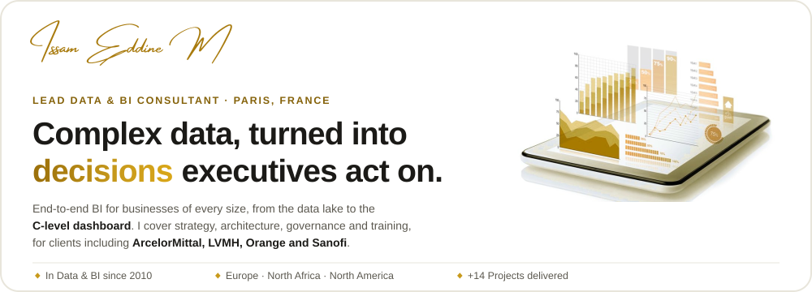
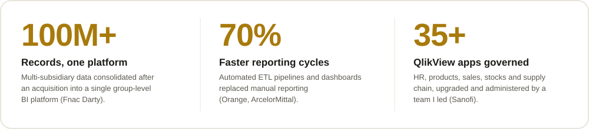
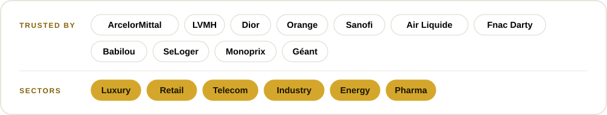

## Results

*What the work changed for clients.*

- Automated global supply chain monitoring for executives (LVMH, Dior).
- Fully automated solutions from data warehouse to dashboards (Géant, Monoprix).

## What I deliver

*From strategy to a dashboard your board opens every Monday.*

<table>
  <tr>
    <td width="33%" valign="top"><b>BI &amp; data strategy</b> A roadmap tied to business objectives, with technology selection and governance that holds as you scale.</td>
    <td width="33%" valign="top"><b>End-to-end delivery</b> Data warehouse, ETL, semantic model and reports, built from scratch or modernized in place.</td>
    <td width="33%" valign="top"><b>Platform architecture</b> Design, security and performance tuning for Power BI, Azure Analysis Services and Qlik estates.</td>
  </tr>
  <tr>
    <td valign="top"><b>KPIs &amp; storytelling</b> Business metrics defined with the people who use them, then shaped into clear executive reporting.</td>
    <td valign="top"><b>Post-merger consolidation</b> Unifying multi-subsidiary data so groups can report on one set of numbers.</td>
    <td valign="top"><b>Training</b> Hands-on training for business users and IT teams so the platform outlives the project.</td>
  </tr>
</table>

### How I usually build it

<table>
  <tr>
    <th align="left">Sources</th>
    <th align="left">ETL</th>
    <th align="left">Semantic model</th>
    <th align="left">Reporting</th>
  </tr>
  <tr>
    <td valign="top">ERP, CRM, files, 100M+ rows</td>
    <td valign="top">SSIS, Python, full automation</td>
    <td valign="top">SSAS / Azure Tabular, DAX</td>
    <td valign="top">Power BI, Qlik, Tableau, Streamlit</td>
  </tr>
</table>

## How I work

*Start from the business question, finish with a dashboard people use.*

I work directly with executives, business teams and IT, and I run projects in **Agile**. Charts come last, after the question and the KPIs are agreed.

1. **Business question.** What decision does this report support?
2. **KPIs and metrics.** Defined with the people who use them.
3. **Model and pipeline.** Warehouse, ETL, semantic model, secured access.
4. **Dashboards and training.** Executive reporting, then training for users and IT.

**When clients call me:** building or modernizing a BI platform · consolidating data after a merger · global reporting and performance programs · governing and scaling an existing BI estate.

## Experience

*Business fluency, technical depth and the project leadership to deliver.*

### Lead Data & BI Consultant · BI Project Manager
**International Data Consulting** · Jan 2015 – present · Europe, hybrid / remote

- Delivered Azure and SSAS Tabular models and Power BI dashboards that automate global and local business analysis, including modernized platforms and paginated reports.
- Delivered and upgraded QlikView applications, including greenfield projects and ETL automation of manual processing.
- Consolidated multi-subsidiary data after an acquisition (100M+ records) to analyze global supply chain, stocks and sales.
- Led a team governing a platform of 35+ QlikView applications: upgrades, updates and administration.
- Helped business teams identify key questions and define the KPIs behind them, then turned results into clear data stories.
- Implemented secure data access policies that keep business units compliant.
- Trained end users on self-service BI and IT teams on platform governance.

`Power BI` `Azure Analysis Services` `SSAS Tabular` `DAX` `QlikView` `Python`

<b>Senior Business Intelligence Consultant</b> · Business Intelligence Consulting · Dec 2010 – Dec 2014 · Tunisia

 

- Gathered requirements, defined KPIs, and wrote business, functional and technical documentation.
- Built data warehouses, data marts and ETL pipelines fully automated.
- Modeled data with SSAS multidimensional cubes and designed dashboards following visualization best practices.
- Implemented data security and access control.
- Delivered automated daily dashboards for sales and retail analytics, and optimized older BI platforms already in production.
- Covered sales, purchasing, production, supply chain, inventory, budgeting and financial reporting.
- Clients included Air Liquide, Géant, Monoprix, SHCI Group and MATECH.

`SSIS` `SSAS` `SSRS` `MDX` `SQL Server` `QlikView` `Tableau`

## Stack

*The tools I build with.*

**Microsoft BI** &nbsp; `Power BI` `Azure Analysis Services` `SSAS Tabular` `SSAS Multidimensional` `SSIS` `SSRS` `Report Builder` `Power Query / M` `DAX` `MDX`

**Other BI platforms** &nbsp; `QlikView (certified)` `Qlik Sense` `Tableau`

**Data & analytics** &nbsp; `SQL Server` `Python` `Streamlit` `Pandas` `NumPy` `Matplotlib` `Seaborn` `Excel` `VBA` `Data modeling` `Data warehousing & ETL`

## Background

*Mathematics first, then data.*

**Bachelor's degree (BAC+4), Information Technology and Mathematics**
Faculté des Sciences Mathématiques, Physiques et Naturelles de Tunis, 2006 – 2010

**Languages:** Arabic (native) · English (full professional) · French (native) · Italian (elementary)

## Contact

*Planning a BI build, a rescue or a consolidation?*

- Email: [issameddine.m@proton.me](mailto:issameddine.m@proton.me)
- LinkedIn: [linkedin.com/in/issameddine-m](https://www.linkedin.com/in/issameddine-m)
- Website: [IssamEddine.com](https://IssamEddine.com)

© 2026 Issam Eddine M · Lead Data & BI Consultant · Paris, France

